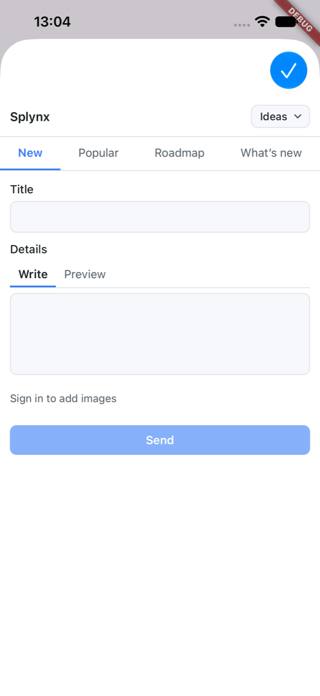
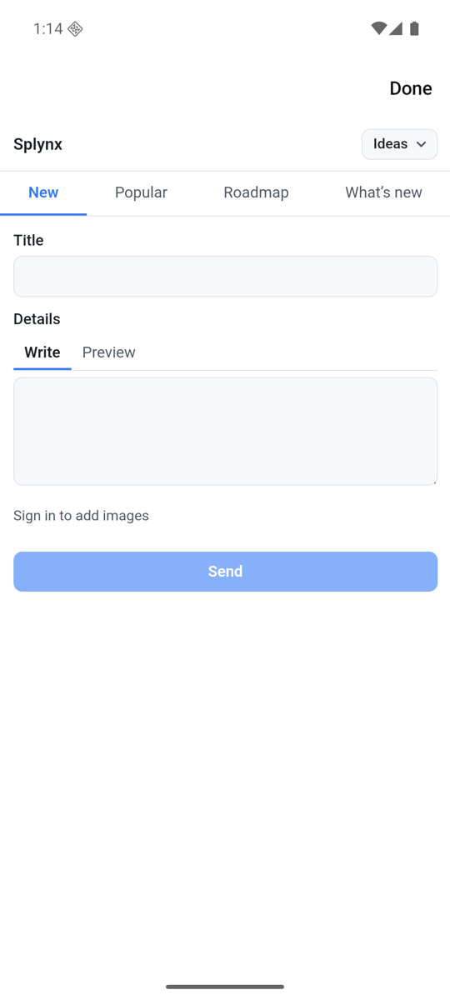

# AntNexo for Flutter

Put your [AntNexo](https://antnexo.com) feedback board, roadmap and What's new inside your Flutter app. People post
ideas and bugs, vote, follow the roadmap and read your release notes without leaving the app. Every post carries the
app's version, OS version and device model, so you know where it came from.

<p>
  
  
</p>

- iOS 15+ and Android 7.0+ (API 24); Flutter 3.35+ (with Swift Package Manager on iOS: Flutter 3.44+, before that
  CocoaPods)
- The person can post as a guest (where your workspace allows it), sign in with an email code, Google or GitHub, or be
  signed in by your app (identify)
- 25 languages; light and dark follow the system
- MIT licence

It is a thin plugin over AntNexo's [Swift](https://github.com/AntNexo/antnexo-swift) and
[Android](https://github.com/AntNexo/antnexo-android) SDKs: the sheet, sign-in, screenshots and the security rules
are theirs, compiled into this plugin. No other dependency.

## Install

From GitHub for now (pub.dev follows):

```yaml
dependencies:
  antnexo:
    git:
      url: https://github.com/AntNexo/antnexo-flutter
      ref: v1.0.0
```

Raise the app's iOS deployment target to 15.0 if it is lower (Xcode: Runner → General → Minimum Deployments; with
CocoaPods also `platform :ios, '15.0'` in `ios/Podfile`).

Don't add `antnexo-swift` or `antnexo-android` to the same app: this plugin already contains them, and Android would
see the classes twice.

## Show the sheet

Configure once at startup with your workspace's board host. Use `https://<slug>.antnexo.com`: it works on every plan
and keeps working if you add or change a custom domain.

```dart
import 'package:antnexo/antnexo.dart';

await AntNexo.configure(host: 'https://acme.antnexo.com', workspace: 'acme');
```

**As a call**

```dart
await AntNexo.show();                          // completes when the sheet is closed again
await AntNexo.show(tab: FeedbackTab.roadmap);
AntNexo.close();                               // closes it from code, as Done does
```

**As a widget** (it renders its `child`; the sheet is native)

```dart
AntNexoSheet(
  visible: _feedback,
  onDismiss: () => setState(() => _feedback = false),
  child: FilledButton(onPressed: () => setState(() => _feedback = true), child: const Text('Send feedback')),
)
```

One sheet at a time: while one is up or opening, `show()` completes at once. Tabs: `newPost`, `popular`, `roadmap`,
`changelog`. More options at `configure`:

```dart
await AntNexo.configure(
  host: 'https://acme.antnexo.com',
  workspace: 'acme',
  options: const FeedbackOptions(
    tabs: [FeedbackTab.newPost, FeedbackTab.roadmap, FeedbackTab.changelog], // which tabs, in that order
    boards: ['ideas', 'bugs'],                   // which boards
    theme: FeedbackTheme.auto,                   // light, dark or auto (the default)
    color: '#4f46e5',                            // accent
    prompts: true,                               // your team's in-app questions
    whatsNew: WhatsNewMode.badge,                // badge, popup or off
    // language: 'de',                           // by default the app's language
  ),
);
```

## Sign the person in from your app (identify)

If your app has its own accounts, sign the person in to the board as themselves: your **backend** signs a short-lived
HS256 JWT with the workspace's identify secret (admin → workspace settings → Widget → Identify secret) — `sub`,
`email`, `exp` (≤ 24 h), optionally `name`, `company`, `mrr` — and the app fetches it when the sheet opens:

```dart
AntNexo.identify(() => myApi.antnexoToken()); // a Future<String?>; null opens signed out
```

The provider is called each time the sheet opens; if it fails, returns nothing or takes longer than 10 seconds, the
sheet opens anyway and the person can sign in our way. **Never put the identify secret in the app.** The token goes to
the page through the native bridge for that one opening, never in a URL or a log.

On every account switch (sign out, another user):

```dart
AntNexo.identify(null);    // or a provider for the new account
await AntNexo.logout();    // clears the sheet's session, closes an open sheet, cancels an opening in progress
```

## What's new badge

```dart
final count = await AntNexo.unreadCount(); // entries the person hasn't seen yet
```

The count stays in step with the sheet: when the person opens What's new there, an `UnreadEvent` reports 0.

## Screenshot

```dart
await AntNexo.show(screenshot: true);
```

Takes a screenshot of the app as it is (before the sheet opens) and offers it as an attachment on the new post. The
person sees it and can remove it; it is uploaded only when they send, only when they are signed in and your workspace
has attachments on. Off by default: the screen can hold private data.

## Events

```dart
final sub = AntNexo.events.listen((e) {
  switch (e) {
    case PostedEvent(:final id): print('new post $id');
    case UnreadEvent(:final count): setState(() => _badge = count);
    case SignedInEvent(:final signedIn): print('signed in: $signedIn');
    case IdentifyFailedEvent(:final code): print('identify refused: $code'); // e.g. an expired token
    case ClosedEvent(): break;
  }
});
await sub.cancel();
```

## Errors

Calls throw `AntNexoException` with a `code`:

| code | when |
|---|---|
| `invalidHost`, `invalidWorkspace`, `invalidOptions` | `configure` got a bad value |
| `notConfigured` | `show` before `configure` |
| `network`, `http` (with `status`), `badResponse` | `unreadCount` couldn't read the changelog (`network` also stands for any unexpected native failure) |
| `unavailable` | the plugin isn't in this build (web, a widget test without a fake, or a rebuild missing), or on Android there was no activity to show the sheet from |

## Privacy

Nothing personal is sent before the sheet opens: the only earlier request is the public changelog, when you call
`unreadCount()` for a badge. With a post the SDK sends the app's name, version and build, the OS and its version, the
device model, the locale and the SDK version — no device identifiers, no advertising ID, no tracking. Your workspace
shows them on the post in the admin; erasing a person removes them. The iOS privacy manifest declares the one
required-reason API the SDK uses (UserDefaults, for the What's new read state).

## How it works (design notes)

- The sheet is AntNexo's widget in app mode (`<host>/app`) in a native WebView with a small bridge, presented by the
  Swift and Android SDKs. Features and fixes to the widget reach your app without an update.
- Why not `webview_flutter`: on Android its JavaScript channels are open to every frame and origin, and it has no way
  to inject the bridge before the page runs; the SDKs' security rules need both.
- The SDKs' sources are vendored at tagged releases by `scripts/vendor.sh` (`vendor.json` records the tags and commits;
  CI checks the copy and the Android dependency versions). On iOS the two Swift modules become the plugin's one; on
  Android the library's namespace is `com.antnexo`, like the SDK's.
- Dart talks to the native side over a [Pigeon](https://pub.dev/packages/pigeon) contract (`pigeon/messages.dart`).
- The identify token is fetched in Dart and handed to native code for one opening only; it is dropped when that sheet
  closes. A close or logout cancels an opening still waiting for its token, and native drops an opening it learns was
  cancelled.
- Posts say `platform: flutter` and this plugin's version.
- The plugin owns the native SDKs' `onEvent` and identify state: in an add-to-app host, use the Dart API for the sheet
  rather than calling the Swift or Android SDK alongside it.
- A hot restart while the sheet is open leaves the sheet up; it closes normally with Done, and the restarted Dart code
  starts with no sheet of its own.
- Everything else — links in the system browser, Google/GitHub sign-in in the system's sign-in sheet, the WebView
  loading only your board's page, logout scope — is described in the
  [Swift](https://github.com/AntNexo/antnexo-swift#how-it-works-design-notes) and
  [Android](https://github.com/AntNexo/antnexo-android#how-it-works-design-notes) READMEs.

## Example app

`example/` uses the plugin from source: `cd example && flutter run`. For scripted checks it takes
`--dart-define=HOST=… WORKSPACE=… IDENTIFY=<token> SCENARIO=show|roadmap|screenshot|sheet`, plus in iOS debug builds
`PROBE="<js>;;<js>"` to run JavaScript in the sheet and print the results; on Android the debug build allows WebView
debugging over Chrome DevTools. The example allows plain HTTP to `*.localhost` for local boards; an app never needs
that.

## Working on the plugin

`scripts/vendor.sh` updates the vendored SDKs to the tags in `vendor.json` (`--check` compares). After editing
`pigeon/messages.dart`, run `dart run pigeon --input pigeon/messages.dart`. Clone the repo into a directory not named
`antnexo-…` (e.g. `antnexo_flutter`): Flutter's Swift Package Manager integration can't resolve the in-repo example
from such a directory. Apps that depend on the plugin aren't affected.

## Licence

MIT
